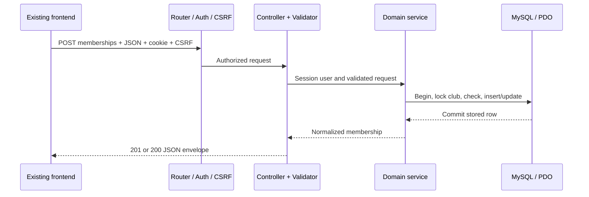

# How the PHP API is implemented

The API implements the existing frontend's 43 method/path pairs under `/api/v1`. Its JSON names, statuses and response shapes follow [API_CONTRACT.md](../../nsbm-sportshub-frontend/docs/API_CONTRACT.md). The frontend keeps calling `api.js`; controllers do not render HTML and views do not need individual PHP URLs.

## Trace one request

For example, a student applies for a club using `POST /api/v1/memberships` with `{"clubId":12}`:

1. `public/index.php` loads the private bootstrap and registers routes. `Request` reads the HTTP method/path and bounded input; JSON mutations require an `application/json` object.
2. `Router` matches the method and path, validates path identifiers, checks authentication/role and checks CSRF for the write. Authorization is enforced again at the controller boundary where appropriate.
3. `MembershipController::create()` obtains the user from the server session. The browser cannot choose `userId` or role.
4. `MembershipService::apply()` validates allowed fields, locks the shared club row and checks the current relationship inside a transaction. It creates a pending row or resubmits an existing rejected row; other duplicates conflict.
5. `Database` uses PDO prepared statements. `Records` joins the saved membership to its user/club names and converts database values into the camelCase response schema.
6. `Response::ok()` emits JSON with 201 for a new relationship or 200 for a rejected-row resubmission. A failed validation or transaction produces a consistent error without partial writes.



## Responsibilities in the source

| Component | Responsibility |
|---|---|
| `src/bootstrap.php` | Load private configuration and register a small `SportsHub\` autoloader; set UTC; suppress browser diagnostics |
| `Core\Request` | Read HTTP input; reject malformed JSON, arrays as bodies and oversized input; provide explicit no-body checks |
| `Core\Router` | Match the registered method/path; authorize before mutation; return 404/405 consistently |
| `Core\Auth` | Native session identity, current-account lookup, session expiry and role rules |
| `Core\Csrf` | Session-bound random tokens, constant-time comparison and same-origin write protection |
| `Core\Validator` | Field allowlists, required/partial schemas, strict types, lengths, enumerations and real date checks |
| `Core\ListQuery` | Shared allowlisted pagination, search, sort and filters with prepared values |
| `Controllers` | Translate HTTP into application calls and choose response status/envelope |
| `Models\Records` | Explicit SQL projections, allowed write columns, joins and SQL-to-JSON normalization |
| `Services` | Transactions and multi-record membership, registration, booking and standings rules |
| `Config\Database` | One configured PDO connection, typed prepared bindings and transaction rollback |
| `Core\Response` / `ApiException` | Consistent JSON output and safe application errors |

`Records` is deliberately a shared mapper rather than ten thin table classes. It does not decide who may approve a request or whether a last slot is available; those decisions belong to controllers/services. This division keeps the implementation small enough to study without an ORM or framework.

## Endpoint inventory

All paths below are relative to `/api/v1`. **User** means an authenticated student or administrator. **Student** means that exact role for a new student workflow. **Admin** means administrator. **Own** means the session user's records; supplying another user ID cannot widen the query. Every write also requires CSRF.

| # | Method | Path | Controller method | Permission |
|---|---|---|---|---|
| 1 | GET | `/auth/session` | `AuthController::session` | Public |
| 2 | POST | `/auth/login` | `AuthController::login` | Public + CSRF |
| 3 | POST | `/auth/logout` | `AuthController::logout` | User |
| 4 | GET | `/dashboard/metrics` | `DashboardController::metrics` | User, role-scoped counts |
| 5 | GET | `/dashboard/activity` | `DashboardController::activity` | User, scoped feed |
| 6 | GET | `/dashboard/upcoming` | `DashboardController::upcoming` | User |
| 7 | GET | `/clubs` | `ClubController::index` | User |
| 8 | GET | `/clubs/:id` | `ClubController::show` | User |
| 9 | POST | `/clubs` | `ClubController::create` | Admin |
| 10 | PUT | `/clubs/:id` | `ClubController::update` | Admin |
| 11 | DELETE | `/clubs/:id` | `ClubController::delete` | Admin |
| 12 | GET | `/memberships` | `MembershipController::index` | Admin |
| 13 | POST | `/memberships` | `MembershipController::create` | Student |
| 14 | PATCH | `/memberships/:id/status` | `MembershipController::status` | Admin |
| 15 | GET | `/users/me/memberships` | `MembershipController::mine` | Own |
| 16 | GET | `/schedules` | `ScheduleController::index` | User |
| 17 | POST | `/schedules` | `ScheduleController::create` | Admin |
| 18 | PUT | `/schedules/:id` | `ScheduleController::update` | Admin |
| 19 | DELETE | `/schedules/:id` | `ScheduleController::delete` | Admin |
| 20 | GET | `/tournaments` | `TournamentController::index` | User |
| 21 | GET | `/tournaments/:id` | `TournamentController::show` | User |
| 22 | POST | `/tournaments` | `TournamentController::create` | Admin |
| 23 | PUT | `/tournaments/:id` | `TournamentController::update` | Admin |
| 24 | DELETE | `/tournaments/:id` | `TournamentController::delete` | Admin |
| 25 | POST | `/tournaments/:id/registrations` | `TournamentController::register` | Student, no body |
| 26 | GET | `/users/me/tournament-registrations` | `TournamentController::registrations` | Own |
| 27 | GET | `/matches` | `MatchController::index` | User |
| 28 | POST | `/matches` | `MatchController::create` | Admin |
| 29 | PUT | `/matches/:id` | `MatchController::update` | Admin |
| 30 | GET | `/tournaments/:id/standings` | `TournamentController::standings` | User |
| 31 | GET | `/facilities` | `BookingController::facilities` | User |
| 32 | GET | `/bookings` | `BookingController::index` | Admin |
| 33 | POST | `/bookings` | `BookingController::create` | Student |
| 34 | PATCH | `/bookings/:id/status` | `BookingController::status` | Admin, or eligible own cancellation |
| 35 | GET | `/users/me/bookings` | `BookingController::mine` | Own |
| 36 | GET | `/users/me/participation` | `UserController::participation` | Own |
| 37 | GET | `/reports/memberships` | `ReportController::memberships` | Admin |
| 38 | GET | `/reports/participation` | `ReportController::participation` | Admin |
| 39 | GET | `/reports/tournaments` | `ReportController::tournaments` | Admin |
| 40 | GET | `/reports/bookings` | `ReportController::bookings` | Admin |
| 41 | GET | `/users/me` | `UserController::show` | Own |
| 42 | PATCH | `/users/me` | `UserController::update` | Own, mutable field allowlist |
| 43 | GET | `/system/health` | `HealthController::show` | Public, actual database probe |

## Validation and response rules

Use full resource bodies for PUT and only the documented mutable subset for PATCH. Numeric IDs/capacities/scores must be JSON integers, not strings or booleans. Notification preference must be boolean. Nullable fields accept JSON `null` only where specified. Unknown properties are rejected rather than ignored, including attempted `userId`, role or calculated-field changes.

Dates must be valid ISO 8601 timestamps with an explicit timezone; impossible calendar dates are rejected rather than normalized. PHP converts them to UTC MySQL `DATETIME(3)` and returns UTC values such as `2027-02-10T10:00:00.000Z`. Ranges require end after start, tournament deadlines before start, and new bookings require a future start and duration no longer than four hours. Text is bounded by field, trimmed where appropriate and kept as data; SQL is never assembled from submitted values.

A normal response is:

```json
{"success":true,"data":{"id":12,"status":"pending"},"message":"Membership request sent"}
```

This is an abbreviated illustration; actual records include all fields in the contract. Lists use `data: []` and a sibling `pagination` object; empty filtered lists have `total: 0` and `totalPages: 0`. Successful DELETE responses use HTTP 204 and an empty body. A validation error is:

```json
{"success":false,"message":"Please check your input.","errors":{"capacity":["Use an integer in the supported range."]}}
```

| Status | Meaning |
|---|---|
| 200 / 201 / 204 | Read/update success, created record, or empty successful deletion |
| 400 | Malformed/unsupported request body or invalid path-identifier form |
| 401 | Login required, expired session, or invalid login |
| 403 | Wrong role/ownership, missing CSRF or rejected origin |
| 404 / 405 | Unknown route/record, or unsupported method with an Allow header |
| 409 | Duplicate relationship, capacity/deadline/state/overlap conflict, or protected dependency |
| 422 | Well-formed request with invalid fields, types, dates, filters or unknown properties |
| 429 | Persistent login-attempt limit exhausted |
| 500 / 503 | Safe internal error, or failed database-backed health/readiness probe |

The central error boundary maps expected database conflicts into safe API errors and rolls transactions back. Raw PDO exceptions, SQL, database credentials and stack traces do not belong in JSON.

## Lists, search and ownership

Paginated lists accept `page` (default 1), `limit` (default 10, maximum 100), `search`, `sort`, `order` (`asc`/`desc`) and the resource's documented filters. Unknown query keys, unsupported sort fields and invalid enumerations return 422. Search is case-insensitive according to the database collation; literal wildcard characters are escaped. Sort/filter column names come from code-owned maps, while values, limits and offsets use prepared bindings.

For example, `/clubs?search=Cricket&sport=Cricket&sort=name&order=asc&page=1&limit=10` counts and pages the same filtered query. A personal list first applies `userId` from the server session and only then adds filters, count and pagination. The four admin reports are paginated aggregate lists with their own allowed fields (and sport filtering for participation). Dashboard endpoints return fixed metrics/feed/upcoming shapes and reject list parameters; consult the contract rather than assuming every GET is paginated.

## Transactions and state transitions

A membership can be reviewed only while pending, and approval checks actual approved capacity. Reapplication of a rejected relationship reuses the unique row with a refreshed application time. Tournament registration checks duplicate identity, deadline and capacity with the tournament locked. Capacity reductions use those same parent locks and cannot go below already approved/registered users.

A pending or approved booking reserves one facility/equipment row. Overlap uses the half-open rule `newStart < existingEnd && newEnd > existingStart`, allowing adjacent reservations. Admin review and student cancellation validate both ownership and current state; rejected/cancelled records are terminal. See [authentication](AUTHENTICATION.md) for exact permissions.

Standings derive from completed results with 3 points for a win, 1 for a draw and 0 for a loss; equal points sort by team name. Scheduled matches retain null scores. Participation combines stored history with real registrations, avoiding a duplicate when a history row already links that registration. No attendance-writing endpoint is invented.

## Extend the implementation deliberately

Start by agreeing a contract change and frontend use case. Register a method/path and its role; add strict input validation; place HTTP translation in the controller, SQL mapping in `Records`, and shared multi-record rules in a service. If changing a capacity or overlap rule, lock the same parent before reading current state. Add a reviewed migration for schema changes instead of editing an applied checksum. Then exercise the real HTTP/database behavior, including rejection and ownership cases, in the isolated test schema.

See [TEST_RESULTS.md](TEST_RESULTS.md) for executed evidence. An endpoint listed here is implementation scope, not a substitute for an actual passing integration run.
