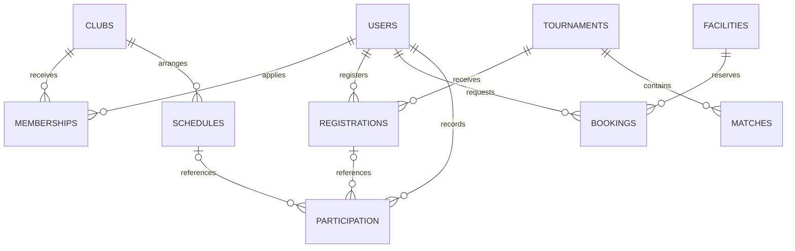

# Database setup and relational design

The verified target is genuine **MySQL 8.0.16 or newer**, using InnoDB and utf8mb4. That minimum matters because the schema relies on enforced CHECK constraints. The migration runner rejects MariaDB: compatibility has not been demonstrated, so an installation labelled “MySQL” that actually runs MariaDB is not a verified substitute.

Use a fresh database for this project. Do not point this backend at the separately selected backup application's database, import its private records or reuse its sessions.

## 1. Install the native prerequisites

You need PHP 8.2+ with `PDO`, `pdo_mysql` and `mbstring`, a supported password-hashing implementation, the MySQL server/client, and a browser. Argon2id is used where PHP supports it; otherwise the application uses a supported native password-hashing fallback. No Composer or frontend build step is required.

### macOS with Homebrew

Install Homebrew from its official instructions if it is not already installed. Check the available formula information, then use an actual versioned MySQL 8.x formula:

```bash
brew info php mysql@8.4
brew install php mysql@8.4
brew services start mysql@8.4
php --version
php -m
php -r 'var_export(password_algos());'
```

Use the installed formula's reported `bin` path for `mysql` if it is not on PATH; Intel and Apple Silicon Homebrew paths differ. Check the MySQL service and actual `SELECT VERSION()` before creating data. Another project may already use port 3306; choose a separate configured port rather than stopping or overwriting its server.

These are macOS setup instructions, not a claim that Homebrew was executed in the Linux cloud task. See [test results](TEST_RESULTS.md) for the platforms actually exercised.

### Linux and Windows

Use the operating system's supported PHP packages/build and genuine MySQL Community Server distribution. Enable `pdo_mysql` and `mbstring` for the PHP binary that will run both the CLI and web server. On Windows, many XAMPP installations include MariaDB under a “MySQL” control; check the actual engine and install a separate genuine MySQL server if needed. Keep database and PHP versions visible during diagnosis; do not disable validation or TLS/package verification to make installation appear successful.

## 2. Create a dedicated database and local account

Open a private administrator client, for example `mysql -u root -p`, and run reviewed SQL with your own private database password:

```sql
CREATE DATABASE sportshub
  CHARACTER SET utf8mb4 COLLATE utf8mb4_unicode_ci;
CREATE USER 'sportshub'@'127.0.0.1'
  IDENTIFIED BY 'REPLACE_WITH_YOUR_PRIVATE_DEVELOPMENT_PASSWORD';
GRANT ALL PRIVILEGES ON sportshub.*
  TO 'sportshub'@'127.0.0.1';
```

This password belongs to the database account, not a website user. The host grant must match the connection method; the example uses TCP `127.0.0.1`. Container-to-container connections use their own matching host grants and `DB_HOST` service name. Do not reuse an empty root password or use the root database account for the web application.

The broad database-specific grant is convenient for local migration. Production should use a separate migration account and a runtime account with only required DML privileges; see [deployment](DEPLOYMENT.md).

## 3. Create private application configuration

From the repository root, copy the example only if you do not already have a configuration:

```bash
[ -f backend/.env ] || cp backend/.env.example backend/.env
chmod 600 backend/.env
```

Edit `backend/.env` privately. Set `DB_HOST`, `DB_PORT`, `DB_NAME`, `DB_USER` and `DB_PASSWORD` to that dedicated database. Keep local `APP_ENV=development` and set `APP_URL=http://localhost:8081` to match the exact browser origin. Never paste your actual password into an issue or shared log. `.env` is ignored by Git and is outside `backend/public/`.

Actual process environment settings take precedence over the file. If a command unexpectedly targets a different database, inspect variable names/presence and the configured account rather than dumping the environment or printing credentials.

## 4. Import the executable schema

The recommended installation command uses the supplied PHP migration runner:

```bash
php backend/database/migrate.php
```

It connects using the same PDO settings as the API, verifies actual MySQL compatibility, takes a database-scoped advisory lock, and executes `backend/database/schema.sql` in dependency order. It records `schema_v1` and the SQL file's checksum in `schema_migrations`. A repeated run verifies the checksum and preserves existing rows. There are no DROP/TRUNCATE operations in the installation schema.

For a fresh database, the SQL is also directly executable using a MySQL client:

```bash
mysql --host=127.0.0.1 --user=sportshub --password sportshub \
  < backend/database/schema.sql
php backend/database/migrate.php
```

The final PHP command records/checks the initial migration state. Prefer the migration runner for normal setup. `CREATE TABLE IF NOT EXISTS` preserves existing tables; it does not repair an arbitrary incompatible schema. Never point either command at an unrelated database. MySQL DDL can auto-commit, so do not assume the schema import can be rolled back like ordinary row updates.

Once applied, preserve the migration's contents. A changed checksum is a stop-and-investigate condition, not a reason to edit the recorded checksum. Future schema changes need a reviewed additive migration and corresponding tests.

## 5. Seed synthetic development data explicitly

```bash
php backend/database/seed.php --confirm-development
```

The seed refuses every `APP_ENV` other than exact `development`, requires the explicit flag, and is not called by server startup. It creates representative clubs, sessions, tournaments, fixtures/results, resources, memberships, bookings and participation without using real student data. Passwords are hashed with PHP. A seed marker makes repeated execution preserve the installed dataset and existing account passwords; it is not a command to reset wanted records or refresh old event dates.

Development-only website logins:

| Role | Email | Public development password |
|---|---|---|
| Student | `student@example.test` | `Student123!` |
| Administrator | `admin@example.test` | `Admin123!` |
| Other student for ownership checks | `other@example.test` | `OtherStudent123!` |

These are synthetic examples, not production accounts. A production database must not contain these seeded identities. Private CLI provisioning for a fresh real administrator is explained in [authentication](AUTHENTICATION.md#private-account-provisioning).

For intentional disposable development resets, read [reset-development.md](../database/reset-development.md). Do not remove migration/seed markers to trick a script into reseeding wanted data.

## 6. Understand the tables

A primary key identifies one row. A foreign key points to a row in another table and prevents a reference to something that does not exist. A unique constraint prevents a duplicate identity or relationship. Indexes let MySQL find relevant rows without scanning every row, but they do not replace business-rule validation.

| Table | Purpose and relationships |
|---|---|
| `users` | Sanitized profiles plus private password hashes; unique email and nullable unique student ID; role student/admin |
| `clubs` | Sports club details and capacity |
| `memberships` | Links users to clubs; one row per user/club pair; pending/approved/rejected |
| `schedules` | Training, match or event attached to a club; start/end/location |
| `tournaments` | Competition details, deadline and registration capacity |
| `registrations` | Links users to tournaments; one row per user/tournament pair |
| `matches` | Tournament fixture, teams, optional scores and scheduled/completed state |
| `facilities` | One reservable facility or equipment unit per row |
| `bookings` | Links a user to a resource and time interval; pending/approved/rejected/cancelled |
| `participation` | User attendance/history, optionally linked to a schedule or registration |
| `activity_logs` | Operational activity for the scoped dashboard feed; not a user-editable record |
| `login_attempts` | Persistent login-throttling buckets shared by PHP workers |
| `schema_migrations` | Applied migration/seed markers and checksums |



Normalization means a club name is stored in `clubs`, not copied into every membership. Queries join the name when returning `clubName`; tournament registration counts and standings are calculated, not accepted from browser input. SQL uses snake_case, while `Records` maps values to the camelCase JSON agreed with the frontend. API timestamps are ISO 8601 UTC; database `DATETIME(3)` values are UTC with milliseconds.

Foreign keys use RESTRICT to preserve operational history. Attempting to delete a referenced club, tournament or schedule returns a conflict rather than silently erasing children. A rejected membership resubmission updates its existing relationship row, preserving user/club uniqueness.

## 7. Rules that need transactions

CHECK/unique constraints cannot alone prevent “two users take the last slot” or overlapping reservations. Services lock the shared parent row first, read the current state, validate, then commit all related writes together:

- Membership approval locks the club before counting approved members.
- Tournament registration locks the tournament before checking capacity/deadline/duplicates.
- Booking creation/review locks the resource before checking active interval overlap.
- Capacity reductions lock the same parent used by approvals/registrations.

Pending and approved bookings block overlapping intervals; rejected/cancelled records do not. Adjacent intervals are valid because overlap is `newStart < existingEnd && newEnd > existingStart`. The test suite exercises actual competing database connections; see [test results](TEST_RESULTS.md).

## Common errors

| Symptom | Meaning and next check |
|---|---|
| PDO “could not find driver” | The selected PHP binary lacks `pdo_mysql`; inspect `php -m` and its loaded configuration |
| Access denied | Check private password, TCP port and account host grant; do not switch the app to database root |
| Unknown database | Create the dedicated schema and confirm `DB_NAME` before migrating |
| Migration checksum mismatch | Applied SQL changed; preserve history and investigate an additive migration |
| Foreign-key error / API 409 | A referenced historical row prevents deletion or an invalid relationship was attempted |
| Duplicate-key conflict | Unique email/student ID or relationship already exists; do not disable the constraint |
| Invalid date or status / API 422 | Compare the submitted types and ISO UTC format to the contract |
| Health 503 | The API could not complete its database probe; inspect private server diagnostics and service readiness |

Do not expose raw SQL/connection exceptions to the browser, disable foreign-key checks on an operating database, or run destructive tests against the development/production application schema.
