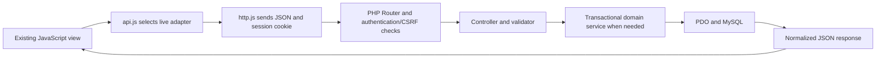

# Backend development guide

This backend implements the agreed SportsHub API for the existing `nsbm-sportshub-frontend/` application. It does not generate another frontend or render a parallel PHP website. Browser views call the existing centralized JavaScript API, which sends JSON to PHP in live mode; PHP validates the request and uses PDO to read or change MySQL records.

The required stack remains HTML, CSS, vanilla JavaScript, PHP and MySQL. No framework, Composer package, JavaScript application runtime or build process is needed. Python/Playwright and Node may be used as optional test tooling; they are not application dependencies.

## Start here

1. [Database setup](DATABASE_SETUP.md): prerequisites, a fresh development database, private configuration, migrations and synthetic seed data, including macOS/Homebrew instructions.
2. [Frontend connection](FRONTEND_CONNECTION.md): serve both parts on one origin and exercise the actual existing UI in live mode.
3. [API implementation](API_IMPLEMENTATION.md): trace a request through routing, validation, controllers, services, SQL mapping and responses; includes the endpoint inventory.
4. [Authentication](AUTHENTICATION.md): sessions, password verification, CSRF, role/ownership checks, cookies and persistent login throttling.
5. [Deployment](DEPLOYMENT.md): PHP hosting, public document root, frontend static files, private configuration and production verification.
6. [Test results](TEST_RESULTS.md): actual commands/results, isolated-database safety and remaining unrun checks.

The original [API contract](../../nsbm-sportshub-frontend/docs/API_CONTRACT.md) is the wire-format authority. The [database guide](../../nsbm-sportshub-frontend/docs/DATABASE_GUIDE.md) explains the relational design. Do not rename a route or change a JSON field in PHP just because a different implementation would be easier.

## Request flow

Ordinary reads can use the SQL record mapper directly. Capacity and reservation workflows need a service because their business rule spans several reads and a write inside one transaction. A transaction alone is not sufficient: the service locks the shared club, tournament or resource parent before making a fresh decision.

## Structure and responsibilities

| Location | Purpose |
|---|---|
| `public/` | The only backend web document root; JSON entry point and Apache rewrite rules |
| `router.php` | Local PHP server routing, including safe serving of the existing static frontend |
| `src/bootstrap.php` | Private configuration, native autoloading and application initialization |
| `src/Config/Database.php` | PDO connection, prepared execution and transaction helpers |
| `src/Core/` | Request/response parsing, route dispatch, authentication, CSRF, validation, pagination and API exceptions |
| `src/Controllers/` | One controller per endpoint family; connect HTTP requests to reusable logic |
| `src/Models/Records.php` | Shared, allowlisted SQL projections and record mapping into camelCase API data |
| `src/Services/` | Membership, tournament registration, booking and standings business rules |
| `database/` | Executable schema, migration runner, explicit development seed and reset guidance |
| `tests/` | API/database/concurrency checks against an isolated disposable database; integration tooling |
| `var/` | Ignored local runtime state such as sessions and local helpers; not public source |
| `.env.example` | Non-secret configuration names and local defaults; copy to ignored `.env` |

A single `Records` mapper replaces ten repetitive one-table model wrappers. It owns column mapping and known record projections, while services own multi-record decisions. This keeps plain PHP understandable without recreating an ORM or a framework. SQL values use prepared statements; dynamic identifiers come from code-owned allowlists.

## Scope and contract resolutions

- Work starts on `feat/sportshub-backend` from frontend baseline `2c11d37` on `feat/sportshub-frontend`. There is no assumed `main` branch and no automatic merge, commit or push.
- The essential shared frontend change is in `js/views/login.js`: each user-initiated login first awaits `api.session()` so a failed login's 401 does not leave the next corrected attempt without CSRF. No automatic POST retry was added. The default mock config, other frontend views/layout and 43-method wire contract remain intact. Frontend documentation/test updates identify the implemented backend and cover this regression.
- No official university assignment PDF is present in this repository. The implementation follows the available contract and project documentation; independent PDF compliance is not claimed.
- A newly created membership returns 201. A rejected membership resubmission reuses its user/club row and returns 200, following the contract's prose and uniqueness rule.
- Deleting a schedule that has linked participation cannot silently erase that history. A foreign-key dependency produces a 409 conflict. Club and tournament dependency protection follows the same principle.
- Registration-backed participation is projected from real registrations. A linked participation record must not create a second copy of the same registration in a user's history.
- `activity_logs`, `login_attempts` and `schema_migrations` are operational tables supporting the documented activity feed, cross-worker login throttling and repeatable schema installation. They do not add new public API features.
- There is no public signup, password-reset, attendance-entry, match-delete, registration-cancellation or facility-management endpoint in this contract. Seed/provisioning is a private CLI operation; it is not an extra public API.
- Notification settings persist a preference. No email or push-delivery service is claimed.

## What to keep private

Never commit `.env`, database credentials, real student exports, session files or production account passwords. Public synthetic development credentials in the setup guide are intentionally restricted to a development-only seed. A local browser's mock records are a separate simulator; they are not imported into MySQL.

Read actual evidence in [TEST_RESULTS.md](TEST_RESULTS.md) before describing readiness. A healthy development instance, a saved configuration and a deployed public host are different outcomes.
