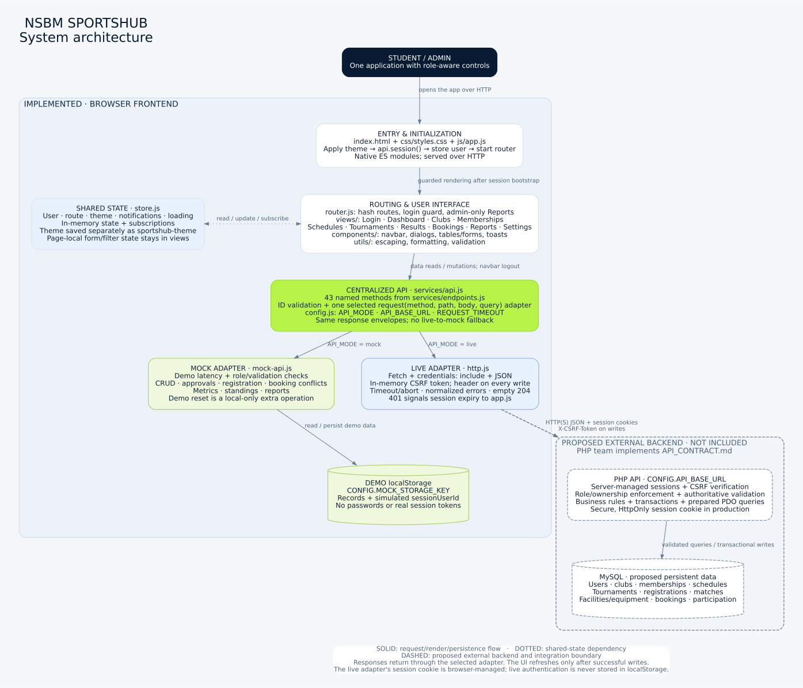
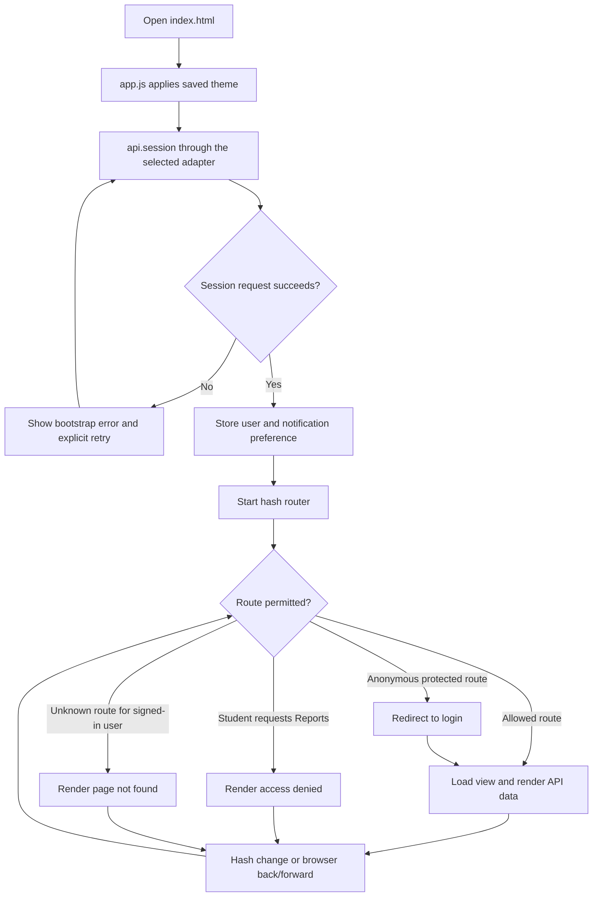
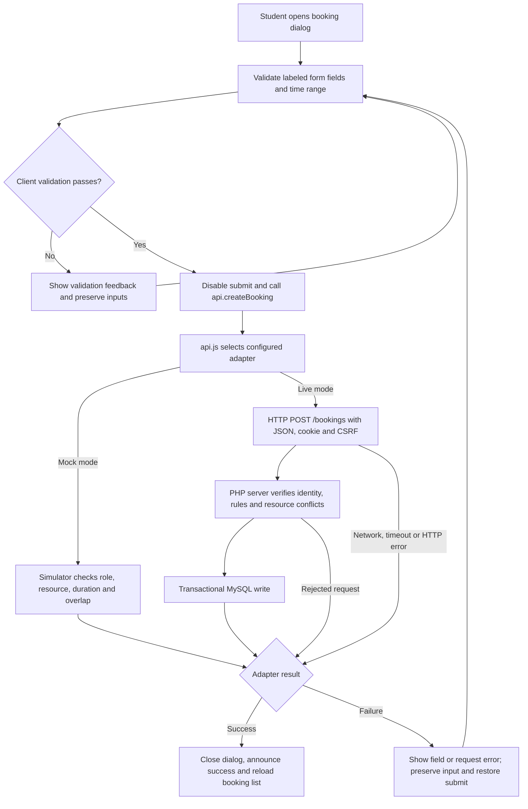

# NSBM SportsHub architecture

This guide describes the application in **`Ckstr-arch/NewProject/nsbm-sportshub-frontend/`**. It connects the diagrams to the actual files so you can follow a request from a button to its data source.

The implemented application is an HTML/CSS/vanilla JavaScript frontend using native ES modules. Its default mode is **mock**. The PHP API and MySQL database shown below are now implemented in the sibling [`backend/`](../../backend/README.md) directory according to [API_CONTRACT.md](API_CONTRACT.md). They are separate server components across a trust boundary. [Backend test results](../../backend/docs/TEST_RESULTS.md) distinguish verified local PHP/MySQL integration from unrun public deployment checks.

## 1. System overview



[Open the full-size scalable diagram](diagrams/architecture.svg) · [Editable Graphviz source](diagrams/architecture.dot)

**Reading the diagram:** solid arrows show request, rendering or persistence flow; dotted arrows show shared-state relationships; dashed boxes and the dashed network connection identify the server-side backend boundary. Responses travel back through the selected adapter. Mock and live are alternative modes; they are not two services called together.

Follow the main path:

1. A student or administrator opens `index.html` through an HTTP server. The browser loads the stylesheet and `js/app.js`.
2. `app.js` applies the theme and restores the session through `api.session()`. Protected views wait for that request to finish.
3. `router.js` checks the route and role, loads the appropriate view, and renders the authenticated shell when needed.
4. Views render records and submit actions through the shared `api` interface. The navbar also uses it for logout.
5. `api.js` converts the named method into a method/path using `endpoints.js`, validates path IDs and invokes the configured adapter.
6. The mock adapter reads and writes browser demo data. The live adapter sends JSON requests to the separately developed PHP API, which must enforce security and business rules before accessing MySQL.

## 2. Module responsibilities

Paths below are relative to `nsbm-sportshub-frontend/`.

| Module | Responsibility | Main collaborators |
|---|---|---|
| [`index.html`](../index.html), [`styles.css`](../css/styles.css) | Static entry, document structure, responsive layout and light/dark presentation | Browser; `app.js` |
| [`app.js`](../js/app.js) | Theme initialization, session bootstrap, global session-expiry handling, bootstrap retry | API, store, router, toast |
| [`router.js`](../js/router.js) | Hash navigation, dynamic imports, route guards, page title, loading/error states, view cleanup and stale-render protection | Store, navbar, views |
| [`store.js`](../js/store.js) | Current user, route, theme, notifications and loading; subscriptions for shared UI updates | App, router, navbar, selected views; theme localStorage |
| [`views/`](../js/views/) | Page-local filters and forms; display API results; validate and submit user actions | API, store, components, utilities |
| [`components/`](../js/components/) | Navigation, native dialogs and focus restoration, tables, labeled form fields, submission feedback and toasts | Views, store; navbar calls API logout |
| [`utils/`](../js/utils/) | Escaping, display formatting and reusable validation helpers | Application and presentation modules |
| [`config.js`](../js/config.js) | Mode, backend prefix, timeout, application name and demo storage settings | API selection and adapters |
| [`endpoints.js`](../js/services/endpoints.js) | One map of **43** public method names to HTTP methods and relative paths | API facade |
| [`api.js`](../js/services/api.js) | Stable interface used by UI callers; select adapter; substitute/validate IDs; emit unauthorized events | Endpoint map, config, one selected adapter |
| [`mock-api.js`](../js/services/mock-api.js) | Simulated requests, demo authentication, CRUD, validation, authorization checks, approvals and derived data | Browser localStorage; shared error type |
| [`http.js`](../js/services/http.js) | Fetch, URL/query construction, cookies, CSRF header, JSON, timeouts, normalized errors and empty 204 responses | Config; PHP API |

The application has no framework, bundler, npm dependency or JavaScript compilation step. The static server serves files; it does not become a business-logic backend. See [FRONTEND_GUIDE.md](FRONTEND_GUIDE.md) for code examples.

## 3. Initialization, navigation and permissions



Every application route requires login except `#/login`. An authenticated user visiting login returns to the dashboard. `#/reports` is the only route restricted entirely to administrators. Other views are shared but show different controls: for example, administrators get club CRUD while students get membership applications. These UI guards are navigation aids; the PHP API must independently check role and ownership.

The router renders each asynchronously loaded view into a detached container. A navigation generation counter ensures a slow previous render cannot replace the latest page. Previous view cleanup and dialog closure run during navigation. Shared state is small; search terms, pagination and unfinished form values belong to their view.

## 4. Live session and CSRF flow

This sequence shows a successful **anonymous bootstrap followed by login** in live mode. The PHP participant is implemented by the controllers and core modules in `backend/src/`.

```mermaid
sequenceDiagram
    autonumber
    participant UI as app.js / login view
    participant API as api.js
    participant HTTP as http.js
    participant PHP as PHP API
    participant State as store.js
    participant Router as router.js

    UI->>API: api.session()
    API->>HTTP: request GET /auth/session
    HTTP->>PHP: GET with credentials included
    PHP-->>HTTP: Anonymous user + csrfToken; session cookie as needed
    Note over HTTP: Retain CSRF token in memory
    HTTP-->>API: Normalized success envelope
    API-->>UI: data.user = null
    UI->>State: Store anonymous user state
    UI->>Router: Start routing
    Router-->>UI: Render login
    Note over UI,PHP: Login view repeats api.session before showing its form<br/>to reacquire anonymous CSRF state after expiry
    UI->>API: api.login with email and password
    API->>HTTP: request POST /auth/login
    HTTP->>PHP: JSON + session cookie + X-CSRF-Token
    PHP->>PHP: Validate credentials and CSRF; rotate session
    PHP-->>HTTP: User + rotated csrfToken; updated cookie as needed
    Note over HTTP: Replace in-memory CSRF token
    HTTP-->>API: Normalized success envelope
    API-->>UI: data.user
    UI->>State: Store authenticated user
    UI->>Router: Navigate to dashboard
    Router-->>UI: Render role-aware dashboard
```

The browser manages the session cookie; JavaScript does not save production session tokens in localStorage. PHP should issue secure, HttpOnly cookies in production. The HTTP client holds its CSRF token inside a closure and sends it on every write, including login and logout. Session, login and logout responses can supply a replacement token. The shared store holds the sanitized user profile, not the CSRF token.

When a request returns **401**, `http.js` clears its CSRF token; `api.js` emits `sportshub:unauthorized`; and `app.js` clears the current user. A previously signed-in user returns to login, whose session handshake reacquires anonymous CSRF state. A **403** displays an access/CSRF error; writes are not automatically retried. See [BACKEND_INTEGRATION.md](BACKEND_INTEGRATION.md) for the server-side requirements.

## 5. A mutation from form to saved data

Example: a student requests a facility or equipment booking.



The mock adapter saves successful requests in localStorage; the live path uses a parent-row lock and transaction in `backend/src/Services/BookingService.php`. Client validation improves feedback, while adapter/server validation is responsible for the operation's final result. A failed request does not permanently change the displayed records, and non-idempotent writes are never silently retried.

Both adapters expose `request(method, path, body, query)` and return the same success/list structures:

```json
{"success":true,"data":{},"message":"Operation completed successfully"}
```

```json
{"success":true,"data":[],"pagination":{"page":1,"limit":10,"total":0,"totalPages":0}}
```

Rejected requests become `ApiError` instances with `message`, `status`, `errors` and `code`. `bindForm` maps field errors to the corresponding inputs; page loaders and toasts handle other failures. A successful empty HTTP 204 is normalized to `{ "success": true, "data": null, "message": "Deleted successfully" }`.

## 6. Storage and security boundaries

| State or data | Location | Lifetime and authority |
|---|---|---|
| Current user, route, notifications, loading | `store.js` memory | Current page lifetime; user is restored through the session API on reload |
| Live CSRF token | `http.js` closure | Current page lifetime; acquired/rotated from authentication responses |
| Theme | localStorage key `sportshub-theme` | Persists across reloads in either mode; appearance only |
| Mock records and simulated login identity | localStorage key `CONFIG.MOCK_STORAGE_KEY` | Mock mode only; Settings reset restores seed data and clears the simulated session |
| Live authentication | Browser-managed cookie + PHP server session storage | Server-controlled identity/expiry; production cookie should be HttpOnly and Secure |
| Real application records | MySQL server | Backend-owned persistent data; schema/transaction design is documented separately |

Mock role checks and local persistence demonstrate workflows, not production security. Anyone controlling the browser can alter demo storage. No passwords or real session tokens are persisted there. `api.resetDemo()` is a mock-only helper; it is **not** one of the 43 backend endpoints.

In live mode, only the HTTP adapter handles application API requests; errors do not trigger a switch to mock data. Views do not call Fetch, read mock storage or know which adapter supplies their records. API-provided text is escaped for display. The PHP backend implements input validation, prepared SQL, authorization, CSRF verification, password hashing and cookie settings. Production HTTPS and hosting behavior still need deployment verification.

## 7. Feature-to-API map

This table is a guide to where each workflow lives. The complete method/path, role, schema, status and error definitions remain in [API_CONTRACT.md](API_CONTRACT.md).

| Route / view | Main API method groups | Role behavior |
|---|---|---|
| `#/login` | `session`, `login` | Anonymous sign-in; mock role hints appear only in demo mode |
| `#/dashboard` | `metrics`, `activity`, `upcoming`, `participation` | Role-aware overview; student participation history |
| `#/clubs` | `listClubs`, `getClub`, club CRUD, `myMemberships`, `applyMembership` | Admin manages; student browses and applies |
| `#/memberships` | `listMemberships`, `myMemberships`, `setMembershipStatus`, `participation` | Admin reviews pending requests; student views own history |
| `#/schedules` | `listSchedules`, schedule CRUD | Both read; admin manages |
| `#/tournaments` | Tournament list/detail/CRUD, `registerTournament`, `myRegistrations`, `listMatches` | Admin manages; student registers and views fixtures |
| `#/results` | `listMatches`, `createMatch`, `updateMatch`, `standings`, `listTournaments` | Both read; admin creates fixtures and records results |
| `#/bookings` | `listFacilities`, `listBookings`, `myBookings`, `createBooking`, `setBookingStatus` | Student requests/cancels eligible own bookings; admin reviews |
| `#/reports` | Membership, participation, tournament and booking report methods | Administrator route only |
| `#/settings` | `profile`, `updateProfile`, `health`, `logout`, mock-only `resetDemo` | Own profile/preferences; accurately labeled connection status |

The MySQL relationships are diagrammed in [DATABASE_GUIDE.md](DATABASE_GUIDE.md#relationships). Do not treat browser demo records as an executable database schema.

## 8. Editing and viewing the diagrams

The overview is an SVG so it stays sharp when zoomed or exported. View it directly using the full-size link above. Its editable source is `docs/diagrams/architecture.dot`; optional **Graphviz** tooling can regenerate it from the frontend root:

```bash
dot -Tsvg docs/diagrams/architecture.dot -o docs/diagrams/architecture.svg
```

Graphviz is documentation tooling only; it adds no application dependency or build step. The additional flow and sequence diagrams are Mermaid blocks embedded in this file and render in GitHub's Markdown view. Edit their text directly when behavior changes.

Maintain these diagrams together with the source and contract: changing an endpoint, adapter interface, authentication rule or storage boundary should update the relevant diagram and the linked integration guides. Browser and adapter verification scope is recorded in [TEST_CHECKLIST.md](TEST_CHECKLIST.md); simulated live responses alone do not establish real PHP/MySQL integration; the backend test record provides separate database-backed evidence.
