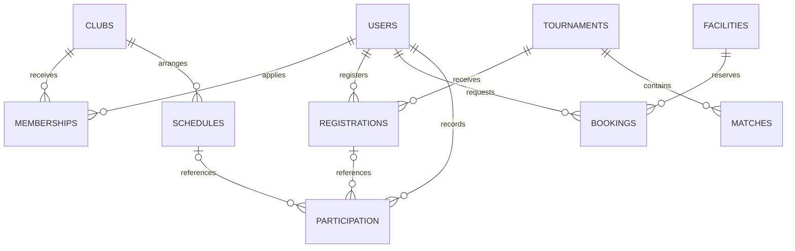

# Proposed MySQL data model

This is the relational design reference. Executable SQL is now implemented in [`backend/database/schema.sql`](../../backend/database/schema.sql), with setup and operational-table details in [DATABASE_SETUP.md](../../backend/docs/DATABASE_SETUP.md). Match the public JSON in [API_CONTRACT.md](API_CONTRACT.md); snake_case SQL columns may be mapped to camelCase JSON at the API boundary. Use InnoDB, utf8mb4, foreign keys, parameterized PDO queries and UTC database timestamps. Convert explicitly when displaying local times.

## Tables and constraints

All `id` columns are positive integer primary keys, normally auto-incremented. Foreign key types must match their referenced keys. Text lengths follow the API contract. `created_at`/`updated_at` are UTC DATETIME/TIMESTAMP values.

| Table | Important columns | Keys and constraints |
|---|---|---|
| `users` | `id`, `name`, `email`, `password_hash`, `role`, nullable `student_id`, nullable `faculty`, `notifications`, timestamps | PK id; UNIQUE normalized email; UNIQUE student_id where non-null; role student/admin; notifications boolean; never return password_hash |
| `clubs` | `id`, `name`, `sport`, `description`, `coach`, `location`, `capacity`, timestamps | PK id; capacity 1–1000; index sport/name; name uniqueness is a backend policy to agree before enforcing |
| `memberships` | `id`, `user_id`, `club_id`, `status`, timestamps | PK id; FK user→users, club→clubs; UNIQUE(user_id,club_id); status pending/approved/rejected; indexes club/status and user/status |
| `schedules` | `id`, `club_id`, `title`, `type`, `starts_at`, `ends_at`, `location`, timestamps | PK id; FK club→clubs; type training/match/event; ends_at>starts_at; index starts_at and club/start |
| `tournaments` | `id`, `name`, `sport`, `description`, `location`, `starts_at`, `ends_at`, `registration_deadline`, `capacity`, timestamps | PK id; end>start; deadline<start; capacity 1–1000; index sport/start |
| `registrations` | `id`, `user_id`, `tournament_id`, `created_at` | PK id; FK user→users, tournament→tournaments; UNIQUE(user_id,tournament_id); index tournament_id |
| `matches` | `id`, `tournament_id`, `home_team`, `away_team`, `starts_at`, nullable `home_score`, nullable `away_score`, `status`, timestamps | PK id; FK tournament→tournaments; teams differ; scores 0–999; scheduled has null scores, completed requires both; index tournament/start |
| `facilities` | `id`, `name`, `type`, `location`, timestamps | PK id; type facility/equipment; one row represents one reservable unit; index type |
| `bookings` | `id`, `user_id`, `facility_id`, `starts_at`, `ends_at`, `purpose`, `status`, timestamps | PK id; FK user→users, facility→facilities; end>start; status pending/approved/rejected/cancelled; index facility/status/start/end and user/start |
| `participation` | `id`, `user_id`, optional `schedule_id`, optional `registration_id`, `event_label`, `sport`, `occurred_at`, `status` | PK id; FK user→users; nullable FKs to schedules/registrations if event-linked; status attended/registered; index user/date and sport/status |

For participation, choose one consistent event identity rule. If linking to a schedule, keep the display event label as a deliberate historical snapshot; if linking to a tournament registration, derive its tournament label. Do not create duplicate attendance on repeated writes. The current frontend reads participation only; attendance-entry/write endpoints are outside this version's contract.

Club and tournament detail responses join or calculate names/counts. Do not duplicate `userName`, `clubName`, `facilityName`, `tournamentName` or `registrationCount` as independently editable fields. The mock adapter may persist denormalized display labels for simplicity; that is not a prescription for SQL storage.

## Relationships

Use RESTRICT for deleting clubs with dependent memberships/schedules, and tournaments with registrations/matches; the API returns 409 so admins can understand why deletion was refused. Avoid accidental cascade deletion of participation or operational history. Account deletion and retention policies need separate agreed requirements; there is no user deletion endpoint here.

## Transaction boundaries

Uniqueness constraints alone do not enforce capacity or interval collision rules. Use transactions and a consistent lock order:

1. **Membership approval:** lock the club row, load the pending request, count approved memberships using a fresh read, verify capacity, update status and commit.
2. **Tournament registration:** lock the tournament row, check its deadline/current registration count, reject duplicate/full registrations, insert and commit.
3. **Booking creation/review:** lock the resource row, check active pending/approved intervals, then create/update and commit. Adjacent reservations do not overlap. Existing rejected/cancelled rows do not block intervals.
4. **Results and reports:** persist scores/status atomically; compute standings from completed matches. Return fresh counts after changes rather than maintaining frontend totals.

Never use a cached frontend count as authority. Handle duplicate-key and transaction errors with normalized 409/503 responses, without exposing SQL statements.

## Standings and reports

Calculate played/won/drawn/lost/points from completed matches; three points for a win, one for a draw, zero for a loss. Sort by points descending then team name. Sport-specific scores and tie breakers need a future contract extension.

Membership reports group statuses by club. Participation reports group attended/registered records by sport. Tournament reports count registrations against capacity. Booking reports group statuses by resource. Aggregate on the server after role checks; avoid returning every user's private record to compute counts in a browser.

## Sessions and configuration

PHP sessions belong in secure session storage, not a browser token table. If using database-backed sessions, isolate its schema/access from public API records. Store application and database secrets in server-managed settings outside the document root. Enforce HTTPS, prepared statements, password hashing, CSRF validation and server-side authorization independently of the frontend. See [backend integration](BACKEND_INTEGRATION.md).

A rejected membership can be resubmitted through POST /memberships. Preserve UNIQUE(user_id,club_id): update that existing row to pending and refresh its request timestamp. Keep any historical review evidence in an audit log rather than duplicating membership rows. New applications return 201; resubmissions return 200.
